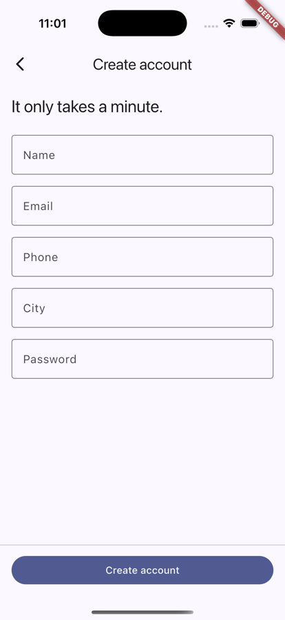
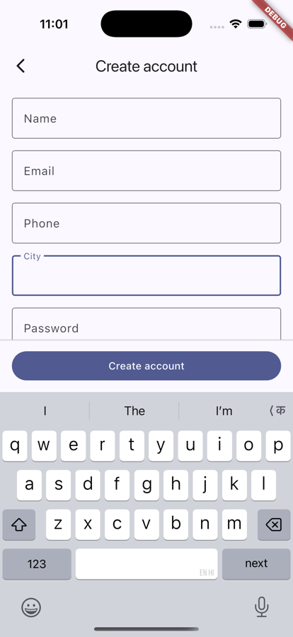
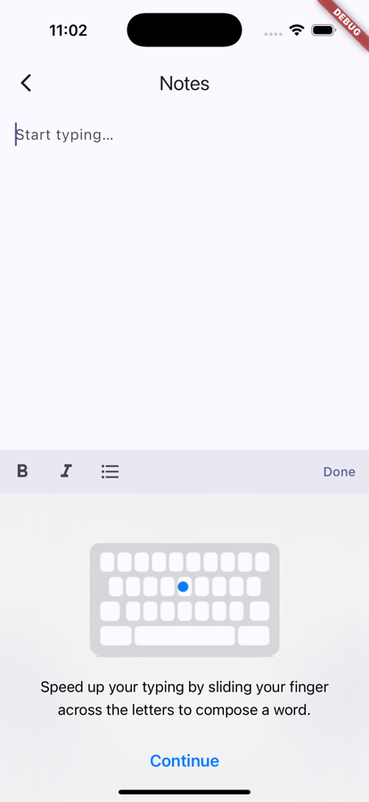

# keyboard_dock

[](https://pub.dev/packages/keyboard_dock)
[](https://github.com/manukumarsb7/keyboard_dock/actions/workflows/ci.yml)

Keeps a footer, like a "Continue" button or a message input, docked at the
bottom of the screen and riding on top of the soft keyboard when it opens.

I kept rewriting the same `viewInsets` math on every form screen, and kept
getting the home-indicator padding wrong in one of the two states. This
package is that code, tested, with no dependencies.

<p>
  
  
  
</p>

## Install

```sh
flutter pub add keyboard_dock
```

## Usage

```dart
import 'package:keyboard_dock/keyboard_dock.dart';

Scaffold(
  appBar: AppBar(title: const Text('Create account')),
  body: KeyboardDock(
    padding: const EdgeInsets.all(16),
    footer: FilledButton(
      onPressed: submit,
      child: const Text('Create account'),
    ),
    child: ListView(children: fields),
  ),
)
```

The child gets all the space above the footer. If it scrolls, Flutter keeps
the focused field visible for you.

With the keyboard closed, the footer sits above the home indicator. With it
open, the footer sits directly on the keyboard. There's no leftover
safe-area gap, which is the bug you usually get when you wrap the footer in
a `SafeArea`. It follows the keyboard animation frame by frame.

It works the same whether your `Scaffold` has `resizeToAvoidBottomInset` on
(the default) or off.

### Only show it while typing

```dart
KeyboardDock(
  visibility: DockVisibility.whenKeyboardOpen,
  footer: Row(
    children: [
      IconButton(onPressed: bold, icon: const Icon(Icons.format_bold)),
      const Spacer(),
      TextButton(
        onPressed: () => FocusScope.of(context).unfocus(),
        child: const Text('Done'),
      ),
    ],
  ),
  child: editor,
)
```

`DockVisibility.whenKeyboardClosed` does the opposite. Use it for a banner
or secondary action that shouldn't eat into the space while typing.

### Background and borders

`decoration` is painted behind the footer **and** the safe-area strip under
it, so the color reaches the bottom edge of the screen:

```dart
KeyboardDock(
  decoration: BoxDecoration(
    color: colors.surface,
    border: Border(top: BorderSide(color: colors.outlineVariant)),
  ),
  // ...
)
```

### Just the keyboard state

`KeyboardVisibilityBuilder` rebuilds when the keyboard opens or closes:

```dart
KeyboardVisibilityBuilder(
  builder: (context, isKeyboardOpen, child) {
    return isKeyboardOpen ? const SizedBox.shrink() : child!;
  },
  child: const Header(),
)
```

It reads the keyboard from the `View` rather than `MediaQuery`. Inside a
resizing `Scaffold`, `MediaQuery.viewInsetsOf(context).bottom` is always 0,
so the usual check silently reports "closed". It only rebuilds when the state
flips, not on every frame of the animation.

## Options

| Parameter | Default | |
|---|---|---|
| `child` | required | Main content, gets the remaining height |
| `footer` | required | Docked widget |
| `visibility` | `always` | `always`, `whenKeyboardOpen`, `whenKeyboardClosed` |
| `padding` | `EdgeInsets.zero` | Space around the footer |
| `decoration` | `null` | Painted behind footer + safe area |
| `safeArea` | `true` | Avoid home indicator and side cutouts |
| `duration` / `curve` | 200ms / `easeOut` | Show/hide animation. Skipped when the OS asks to reduce motion |

## Coming from keyboard_attachable

`KeyboardAttachable` + `FooterLayout` map to a single `KeyboardDock`:

```dart
// before
FooterLayout(
  footer: KeyboardAttachable(child: button),
  child: content,
)

// after
KeyboardDock(footer: button, child: content)
```

There's no native plugin, so there's nothing to add to your Podfile or Gradle
files and no `flutter_keyboard_visibility` version to keep in sync.

## Limitations

- Mobile web browsers mostly don't report the keyboard height to Flutter, so
  the footer won't move there. It still lays out fine.
- Floating and split keyboards on iPad report no inset, so the footer stays
  at the bottom. That's usually what you want.

## Contributing

Issues and PRs are welcome. Please run `flutter analyze` and `flutter test`
before opening a PR.
